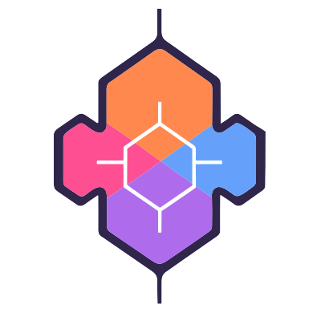

<div align="center">
  <br><p><strong>array-split-by</strong> - `splitBy(array, iteratee)`</p>
</div>

------------------------------------------------

[](https://circleci.com/gh/FGRibreau/array-split-by/) [](https://coveralls.io/github/FGRibreau/splitBy?branch=master) [](https://david-dm.org/FGRibreau/array-split-by) [](http://badge.fury.io/js/array-split-by)

<!-- [](https://www.npmjs.com/package/array-split-by) -->

[](https://www.codementor.io/francois-guillaume-ribreau?utm_source=github&utm_medium=button&utm_term=francois-guillaume-ribreau&utm_campaign=github)  [](http://bit.ly/2c7uFJq)  [](https://join.slack.com/t/fgribreau/shared_invite/zt-edpjwt2t-Zh39mDUMNQ0QOr9qOj~jrg)

<!--   -->

## Usage

Like [String.prototype.split](https://developer.mozilla.org/en-US/docs/Web/JavaScript/Reference/Global_Objects/String/split) except that it works on array and accepts an iteratee which is invoked for each element in array to generate the criterion by which the separation is computed. The order of result values is determined by the order they occur in the array. The iteratee is invoked with three argument: `(value, index, chunk, array)`

## Sponsors

<table>
  <tr>
    <td align="center" width="175">
      <a href="https://france-nuage.fr/?mtm_source=github&mtm_medium=sponsor&mtm_campaign=france-nuage&mtm_content=array-split-by">
        <br/>
        <b>France-Nuage</b>
      </a><br/>
      <sub>Sovereign French cloud you can reinternalise. Open infra, no vendor lock-in.</sub>
    </td>
    <td align="center" width="175">
      <a href="https://www.hook0.com/?mtm_source=github&mtm_medium=sponsor&mtm_campaign=hook0&mtm_content=array-split-by">
        <br/>
        <b>Hook0</b>
      </a><br/>
      <sub>Ship webhooks without writing the delivery, retry &amp; signing code yourself.</sub>
    </td>
    <td align="center" width="175">
      <a href="https://getnatalia.com/?mtm_source=github&mtm_medium=sponsor&mtm_campaign=natalia&mtm_content=array-split-by">
        <br/>
        <b>Natalia</b>
      </a><br/>
      <sub>Stop losing inbound leads while you push commits. AI picks up 24/7.</sub>
    </td>
    <td align="center" width="175">
      <a href="https://netir.fr/?mtm_source=github&mtm_medium=sponsor&mtm_campaign=netir&mtm_content=array-split-by">
        <br/>
        <b>NetIR</b>
      </a><br/>
      <sub>Hire vetted French freelance devs or list yourself on the marketplace.</sub>
    </td>
  </tr>
  <tr>
    <td align="center" width="233">
      <a href="https://nobullshitconseil.com/?mtm_source=github&mtm_medium=sponsor&mtm_campaign=nbc&mtm_content=array-split-by">
        <br/>
        <b>NoBullshitConseil</b>
      </a><br/>
      <sub>Tech advisory without the bullshit. Execs unblocked, decisions made.</sub>
    </td>
    <td align="center" width="233">
      <a href="https://qualneo.fr/?mtm_source=github&mtm_medium=sponsor&mtm_campaign=qualneo&mtm_content=array-split-by">
        <br/>
        <b>Qualneo</b>
      </a><br/>
      <sub>LMS wiring the 32 Qualiopi indicators for French training orgs.</sub>
    </td>
    <td align="center" width="233">
      <a href="https://recapro.ai/?mtm_source=github&mtm_medium=sponsor&mtm_campaign=recapro&mtm_content=array-split-by">
        <br/>
        <b>Recapro</b>
      </a><br/>
      <sub>Private AI that transcribes meetings &amp; writes the report for you.</sub>
    </td>
  </tr>
</table>

> **Interested in sponsoring?** [Get in touch](mailto:rust@fgribreau.com)

## Installation

Install with [npm](https://npmjs.org/package/splitby).

    npm install --save array-split-by


### Example

```javascript
const splitBy = require('array-split-by');

splitBy([1, 2, 3, "|", 4, 5, 6], val => val === "|"); // [[1, 2, 3], [4, 5, 6]]

splitBy([1, 2, 3], val => val % 2 === 0); // [[1], [3]]

splitBy([{x:0, a:true}, {x:1, a:true}, {x:2, a:false}, {x:1, a:true}], (val) => !val.a); // [[{"a": true, "x": 0}, {"a": true, "x": 1}], [{"a": true, "x": 1}]
```


## [Changelog](CHANGELOG.md)

## CI

- set the env. variable `COVERALLS_REPO_TOKEN`, create it with: https://coveralls.io/


## You want to support my work?

I maintain this project in my free time, if it helped you, well, I would be grateful to buy a beer thanks to your [paypal](https://paypal.me/fgribreau) or [Bitcoins](https://www.coinbase.com/fgribreau), donation!

[Francois-Guillaume Ribreau](http://fgribreau.com) (npm@fgribreau.com)
